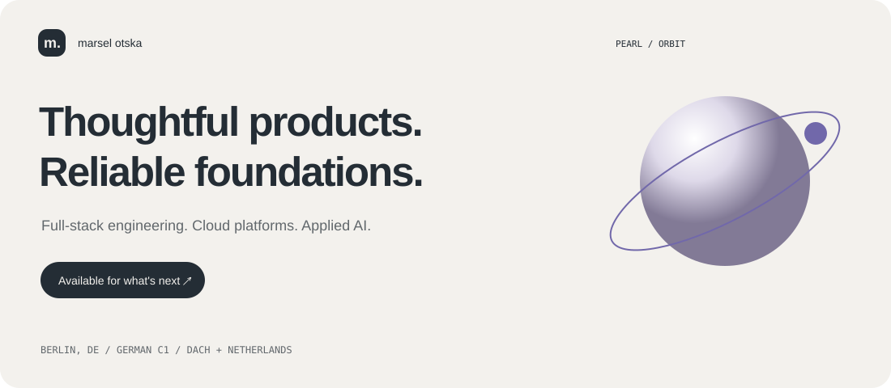

 

## 💫 About Me

**React · TypeScript · Node.js · NestJS · C# / .NET · AWS**

I build software for teams that need to act on live data. At Siemens, that meant getting equipment readings onto an operator’s dashboard. In healthcare, it meant connecting a clinical assistant’s streaming interface to the services behind it. I have 6+ years of software engineering experience across industrial, healthcare and security products.

**Available immediately** for senior full-stack, backend, frontend and cloud engineering roles. Open to remote or hybrid opportunities in Germany, Austria, Switzerland, the Netherlands, Sweden and Greece.  
**Languages:** German (C1), English (C1), Greek (native).  
[Email me](mailto:marselotska@gmail.com) · [LinkedIn](https://www.linkedin.com/in/marselotska/)

## 💼 Selected Engineering Work

- **Siemens · Industrial monitoring.** Connected equipment data from MQTT and OPC UA to React dashboards through WebSockets. Built backend integrations in .NET Core, FastAPI and Go, and deployed application services on AWS.
- **TMA Telemedical Application · Healthcare software.** Led a five-person team delivering a healthcare platform across three EU countries. Built the clinical assistant’s streaming UI and its OpenAI and LangChain integration. Used Kafka and RabbitMQ for asynchronous backend workflows.
- **Li-T Security · Deployment automation.** Automated releases with GitHub Actions and Jenkins, cutting deployment cycles from hours to under 15 minutes. Deployed NestJS and .NET services on Kubernetes and used Kafka for audit logging.

## 🌐 Connect With Me

 

## 🧰 Tech Stack

**Backend**

**Frontend & Mobile**

**Cloud & DevOps**

**Data & Messaging**

**AI**

**Design & Tools**

 

## 📊 GitHub Stats

